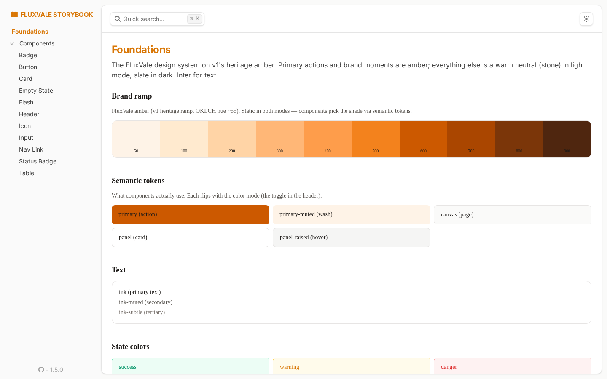

# Design system (#178)

Amber on warm neutrals, on hand-written Tailwind — v1's heritage
ramp, v2's component set. The living reference is the **storybook**:
`/storybook` in dev, [storybook.fluxvale.com](https://storybook.fluxvale.com)
on staging (fleet-routed, internal-only, `STORYBOOK_ENABLED`-gated).

## Tokens (`apps/platform/assets/css/app.css`)

- **Brand ramp** `--color-brand-50..900` — the v1 "Flux Stream" amber
  (OKLCH, hue ~55), ported verbatim; static in both modes.
- **Semantic tokens** flip with `[data-theme=dark]` (the root layout's
  theme script): `primary` (+hover/active/muted/on-), `canvas` /
  `panel` / `panel-raised` (surfaces), `ink` / `ink-muted` /
  `ink-subtle` (text), `line` / `line-strong` (borders), `success` /
  `warning` / `danger` (+muted, line- variants), `focus`.
  Mapped to utilities via `@theme inline` — `bg-primary`,
  `text-ink-muted`, `border-line` … Dark side is v1's slate verbatim;
  light neutrals warmed to stone to sit with amber.
- **Inter** (v1 heritage), vendored woff2 in `priv/static/fonts/`.
- `bg-brand-gradient` — tonal amber gradient, reserved for
  hero/marketing surfaces.

## Components (`FluxValeWeb.CoreComponents`)

All hand-written Tailwind on the tokens (repo rule: no daisyUI in the
system). `class` passed by a caller is **appended**, never replaces.
Component set: `button` (4 variants × 3 sizes, link-aware), `input`
(text/select/textarea/checkbox, danger-error state), `card`, `badge`
(5 tones), `status_badge` (instance lifecycle, pulsing dot on
in-motion states), `table` (stream-ready), `flash` (toasts), `nav_link`
(active state), `header`, `empty_state`, `icon`, `list`.

## Surfaces on the system

Migrated: **everything** — wave 1 (#185): shared chrome
(`Layouts.app`/`public`, theme toggle), landing, catalog (live + public
SSR), instances index, billing index; wave 2: sign-in, deploy wizard
(instance show, first-run guidance, admin reveal), instance show,
top-up wizard. **daisyUI is removed from the dependency tree** — every
surface is hand-written Tailwind on the tokens; the transitional
aligned-themes stopgap is gone with it.

New in wave 2: `stepper` (wizard progress, testid-prefix aware) and
`callout` (info/warning/danger/success notices) join the component set;
`<.input>` now appends caller classes instead of replacing the base.

## Storybook

- Stories: `apps/platform/storybook/` — `foundations.story.exs` (token
  reference page) + one story per component. Filename contracts:
  pages are `*.story.exs` too; folder indexes are `_*.index.exs`.
- Assets: `assets/css/storybook.css` (loads INSTEAD of app.css —
  mirrors tokens, no daisyUI, proving components stand on tokens
  alone) and `assets/css/storybook_theme.css` (rethemes the workshop
  chrome from violet to amber). Built via the `:storybook` /
  `:storybook_theme` tailwind profiles (`mix assets.build`).
- Gate: `FluxValeWeb.Plugs.StorybookEnabled` — runtime plug like the
  TestInbox; `STORYBOOK_ENABLED` flips it (staging), prod 404s.

## Vision QA (#178)

Wave 1 (#185): three rounds with an image-capable reviewer model over
Playwright screenshots (light + dark) — round 1 caught the dark-mode
viewport seam, a crashed table story, blank input stories, and the
violet workshop chrome; round 2 the billing phantom divider + input
crash; round 3 converged — **GENUINELY GOOD — ship it**.

Wave 2: per-surface convergence with the same loop — sign-in **GOOD**
(1 round); deploy wizard **GOOD** (3: leaked "(M3)" copy, faint
disabled-Continue, Configuration card width); instance show **GOOD**
(1); top-up + new stories **GOOD** (2: a stepper bug where string
step-ids never matched the atom step and Elixir's term order painted
every step done, sandbox serif pinned to Inter, paired wizard
actions). Final screenshots:
[docs/design/screenshots/wave2/](design/screenshots/wave2/).
